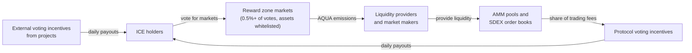

> For the complete documentation index, see [llms.txt](https://docs.aqua.network/llms.txt). Markdown versions of documentation pages are available by appending `.md` to page URLs; this page is available as [Markdown](https://docs.aqua.network/voting-and-rewards/aquarius-voting.md).

# Aquarius voting

How ICE holders direct SDEX and AMM rewards by voting for markets — eligibility threshold, ranking, and the reward cap.

Aquarius lets the AQUA-holding community vote on where liquidity incentives should flow across the Stellar order book DEX and the Aquarius AMM. Voting power comes from [locking AQUA into ICE](/aqua-and-ice/ice-tokens-locking-aqua-and-getting-benefits.md): users place **ICE** votes on the markets they value most, and markets that gather enough votes become eligible for Stellar DEX (SDEX) and AMM rewards.

Learn more about the two reward streams:

* [SDEX Rewards](/voting-and-rewards/sdex-rewards.md) – distributed automatically every hour to liquidity providers on the Stellar order book.
* [AMM Rewards](/voting-and-rewards/aquarius-amm-rewards.md) – accrued every block by liquidity providers, claimed manually.

### What makes voting verifiable?

Voting happens entirely on the Stellar blockchain. Each voting transaction and its claimable balance are verifiable on-chain. Voters can later reclaim the ICE from a claimable balance to withdraw an allocation.

### How liquidity voting works

When you select market pairs and commit ICE to them, the voting platform generates transactions containing claimable balances. They are submitted to the Stellar network and processed in the next available ledger (typically within 5 seconds). The allocation remains active until you withdraw it. To change an allocation, reclaim its claimable balance and submit a new vote.

### The incentive loop

Votes, rewards, liquidity, and voting incentives form one circuit:

Voters direct emissions, emissions attract liquidity, liquidity generates trading fees, and a share of those fees flows back to voters as [protocol voting incentives](/for-projects/what-are-voting-incentives.md) — while projects can join the circuit directly with external voting incentives.

### Reward distribution

For a market to qualify for SDEX and AMM rewards, it must receive at least **0.5% of all votes** cast in liquidity voting, and both assets must be whitelisted in the [Asset Registry](/governance/asset-registry.md). For example:

* If 1 billion upvoteICE is committed to liquidity voting, a market needs at least 5 million upvoteICE in votes to become eligible.
* At the 0.5% threshold, up to 200 markets can receive AQUA rewards at the same time.

Once eligible, a market's reward share follows its ranking: a market with 5% of total votes earns twice as much as one with 2.5%.

### Reward cap

A single market's daily reward share is capped at **10%**. With 7 million AQUA allocated daily to SDEX and AMM rewards, one market can receive at most 700,000 AQUA per day. Votes beyond the cap don't increase that market's rewards — the excess is not converted into emissions and is not redistributed to other markets. As a result, the total distributed per day can be below the daily allocation.

[Learn how to vote for markets in the step-by-step guide](/user-guides/how-to-vote-for-markets-on-aquarius.md).
